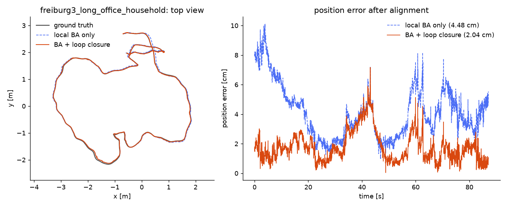
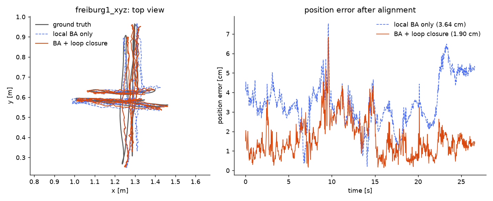
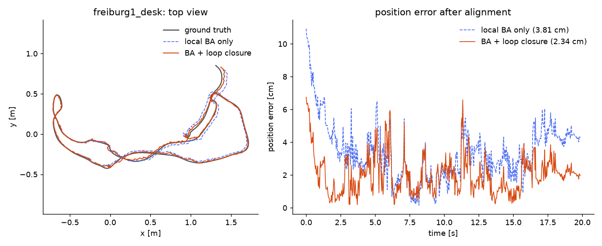

# lynx

Visual SLAM for RGB-D cameras, written from scratch in C++17 with Eigen and OpenCV.
It runs on a CPU (about 9 ms per frame on a laptop) and is evaluated on the TUM RGB-D
benchmark with evo.

I built it to understand each part of a SLAM system by implementing it myself:
the SE(3) math, PnP, bundle adjustment, bag of words and pose graph optimization.
OpenCV is used only for image I/O, ORB extraction, brute-force matching and
undistortion. All the geometry
and the optimizers are my own code on top of Eigen.



## Pipeline

1. **Tracking.** ORB features (1500 per frame). Depth comes from the TUM depth
   image. Each frame is matched to the last keyframe and its pose is found with
   EPnP + RANSAC, then refined with Levenberg-Marquardt on the reprojection error.
2. **Local map.** New keyframes reuse the map points of the previous keyframe when
   the descriptors match, so the same 3D point is seen by many keyframes.
3. **Local bundle adjustment.** The last 7 keyframes and their points are optimized
   together. Depth enters the residual as a virtual right-image coordinate, like a
   stereo rig. The point blocks are removed with the Schur complement. Each
   observation is weighted by the ORB octave (sigma = 1.2^octave), with a Huber
   kernel.
4. **Loop detection.** A vocabulary tree (k = 10, L = 4, about 10k words) turns
   each keyframe into a tf-idf bag of words. An inverted index gives the candidates.
   A candidate must be at least 30 keyframes old and score at least 0.75 times the
   score with the previous keyframe. The best 3 candidates are checked with PnP
   against the candidate's map points (at least 50 inliers).
5. **Pose graph.** Odometry edges, covisibility edges (at least 100 shared points)
   and loop edges, optimized on SE(3) with sparse Levenberg-Marquardt. Each map
   point then moves with the keyframe that observed it last.

The pose graph uses analytic Jacobians in the tangent space. All modules have unit
tests with synthetic data (44 tests, GoogleTest).

## Results

TUM RGB-D, full sequences, one run each. ATE is the translation RMSE after an SE(3)
alignment (no scale). RPE is the translation RMSE over 30-frame windows (about 1 s).
All numbers come from evo with `scripts/evaluate.py`.

| Sequence | Frames | Version | ATE RMSE | ATE max | RPE (30 frames) |
|---|---|---|---|---|---|
| fr1/xyz | 798 | frame-to-keyframe VO | 3.98 cm | 7.60 cm | 2.25 cm |
| | | + shared map points | 3.26 cm | 6.95 cm | 2.06 cm |
| | | + local BA | 3.64 cm | 7.54 cm | 2.09 cm |
| | | + loop closure | **1.90 cm** | 6.83 cm | 2.05 cm |
| fr1/desk | 596 | frame-to-keyframe VO | 8.27 cm | 20.1 cm | 3.91 cm |
| | | + shared map points | 5.08 cm | 9.40 cm | 3.30 cm |
| | | + local BA | 3.81 cm | 10.9 cm | 3.19 cm |
| | | + loop closure | **2.34 cm** | 6.75 cm | 3.14 cm |
| fr3/long_office_household | 2488 | local BA | 4.48 cm | 10.1 cm | 1.14 cm |
| | | + loop closure | **2.04 cm** | 7.17 cm | 1.16 cm |

With loop closure, no frame was lost on any sequence:

| Sequence | Keyframes | Loops closed | Time per frame |
|---|---|---|---|
| fr1/xyz | 36 | 6 | 9.0 ms |
| fr1/desk | 58 | 7 | 10.4 ms |
| fr3/long_office_household | 98 | 14 | 8.5 ms |

On fr3/long_office_household the camera goes around the office and comes back to
the start. The loops connect keyframes 79-97 with keyframes 2-6, and the ATE drops
from 4.48 cm to 2.04 cm.

| fr1/xyz | fr1/desk |
|---|---|
|  |  |

Things to keep in mind when reading the table:

- The vocabulary was trained on images from fr1/xyz and fr1/desk, so the fr1 loop
  closure numbers are not a clean test. fr3/long_office_household was not used for
  training, so it is the fair one.
- On fr1/xyz most of the gain before loop closure comes from the shared map points,
  not from bundle adjustment. Local BA makes the ATE slightly worse there, and
  better on fr1/desk.
- Loop closure fixes the drift over the whole trajectory, so the ATE drops. The
  local error (RPE) stays about the same.
- These are single runs. RANSAC is seeded, so the results are repeatable on the
  same machine.

## Build

Tested on Windows 11 with Visual Studio 2022 (MSVC) and CMake 3.20+.

1. Download the prebuilt OpenCV for Windows (4.x) and extract it so that
   `third_party/opencv/build/OpenCVConfig.cmake` exists.
2. Configure and build from a "x64 Native Tools" prompt:

```bash
cmake -S . -B build -G Ninja -DCMAKE_BUILD_TYPE=Release
```

```bash
cmake --build build
```

Eigen 3.4.0 and GoogleTest 1.15.2 are downloaded by CMake with FetchContent. The
OpenCV DLL is copied next to the executables.

Run the tests (the end-to-end tests are skipped if the dataset is not in `data/`):

```bash
ctest --test-dir build --output-on-failure
```

## Usage

Download the sequences from the
[TUM RGB-D benchmark](https://cvg.cit.tum.de/data/datasets/rgbd-dataset/download)
and extract them into `data/`.

Train the vocabulary (one image every 10 frames):

```bash
build/lynx_vocab data/orb_vocab.bin data/rgbd_dataset_freiburg1_xyz data/rgbd_dataset_freiburg1_desk
```

Run on a sequence. The trajectory is written in TUM format. Without `--vocab` there
is no loop closure, `--no-ba` also turns off local BA:

```bash
build/lynx_vo data/rgbd_dataset_freiburg3_long_office_household results/fr3.txt --vocab data/orb_vocab.bin
```

Evaluate with evo and plot (Python with `evo` and `matplotlib`):

```bash
python scripts/evaluate.py results/fr3.txt=data/rgbd_dataset_freiburg3_long_office_household
```

```bash
python scripts/plot.py results/fr3.txt data/rgbd_dataset_freiburg3_long_office_household docs/fr3.png --label "BA + loop closure"
```

`plot.py` also takes `--before other.txt --before-label "..."` to draw a second
trajectory for comparison.

## Code layout

```
include/lynx/   headers
  se3            SE(3) Lie group: exp, log, adjoint, left Jacobians
  geometry       triangulation, EPnP, PnP RANSAC + LM
  frontend       ORB extraction and matching
  ba             bundle adjustment with Schur complement
  map            keyframes, map points, covisibility
  pose_graph     pose graph optimization on SE(3)
  vocabulary     vocabulary tree, bag of words, tf-idf
  loop_closure   loop detection, geometric check, map correction
  odometry       the full pipeline on a TUM sequence
src/            implementation
apps/           lynx_vo, lynx_vocab
tests/          GoogleTest unit and end-to-end tests
scripts/        evo evaluation and plots
```

## Limitations

- RGB-D only: depth comes from the sensor, there is no monocular or stereo mode.
- No global bundle adjustment after loop closure, only the pose graph.
- No relocalization: if PnP fails, the pose is predicted with the last motion and
  a new keyframe starts from there, so the error of that guess stays in the map.
- Pinhole camera with OpenCV undistortion, TUM calibration only.
- Single thread. Tracking, local BA and loop closure run one after the other.
